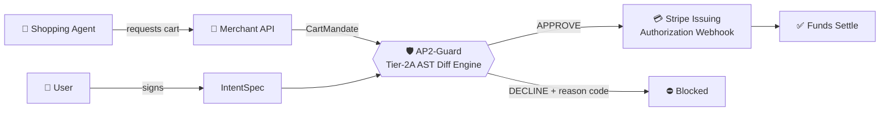

<div align="center">
# 🛡️ AP2-Guard
 
### Semantic Payment Firewall & Delegated Authorization Proxy
 
**A deterministic, sub-millisecond payment authorization proxy for agentic commerce and autonomous financial workflows.**
 
[](https://ap2-guard.vercel.app)


 
[**Live Demo**](https://ap2-guard.vercel.app) · [**Architecture**](#-system-architecture) · [**Attack Taxonomy**](#-tested-attack-taxonomies) · [**Quickstart**](#-quickstart)
 
</div>
---
 
## 📑 Table of Contents
 
- [Overview](#-overview)
- [Key Features](#-key-features)
- [System Architecture](#-system-architecture)
- [How It Works](#-how-it-works)
- [Tested Attack Taxonomies](#-tested-attack-taxonomies)
- [Performance](#-performance)
- [Repository Structure](#-repository-structure)
- [Tech Stack](#-tech-stack)
- [Quickstart](#-quickstart)
- [Running Tests](#-running-tests)
- [Engineering Highlights](#-engineering-highlights)
---
 
## 🚀 Overview
 
As autonomous AI agents gain transactional capabilities through tools like **Google AP2 (Agent Payments Protocol)** and **Stripe Issuing**, they also introduce serious security risks:
 
- **Indirect Prompt Injection (IPI)** — malicious content hijacks the agent's goals
- **Destination hijacking** — the agent is tricked into buying something other than what the user intended
- **Unauthorized fee padding** — hidden line items inflate the final charge
**AP2-Guard** is a deterministic validation proxy that intercepts merchant cart mandates **before funds settle**. It enforces cryptographic **WYSIWYS (What You See Is What You Sign)** passkey intent bindings, guaranteeing that an agent cannot deviate from the financial constraints the user signed.
 
> **Core principle:** the agent may be compromised, but the money cannot move outside what the user explicitly authorized.
 
---
 
## ✨ Key Features
 
| Feature | Description |
| :--- | :--- |
| ⚡ **Sub-millisecond verification** | Tier-2A AST diff engine evaluates intent vs. cart in under 0.3 ms |
| 🧠 **Zero LLM in the hot path** | Fully deterministic, so there is no probabilistic inference and no prompt-injectable decision layer |
| 🔐 **WYSIWYS intent binding** | User-signed `IntentSpec` is cryptographically bound to the approved cart |
| 💳 **Stripe Issuing integration** | Synchronous authorization webhook returns signed `APPROVE` / `DECLINE` within provider timeouts (< 2.0 s) |
| 🧾 **Explicit reason codes** | Every decision returns a machine-readable, auditable disposition |
| 🖥️ **Visual inspector** | Next.js dashboard with an interactive attack sandbox |
 
---
 
## 🏛️ System Architecture
 
AP2-Guard uses a strictly decoupled design that separates **cryptographic verification** from **merchant execution**.
 

 
### Components
 
1. **User IntentSpec (client-signed)** — Encodes strict financial boundaries:
   - `max_amount_cents` — maximum spend cap
   - `allowed_mccs` — permitted Merchant Category Codes
   - `dest_iata` — geographic destination whitelist
   - minimum refundability standards
2. **Merchant CartMandate (server-received)** — The line-item cart returned by the merchant API or autonomous shopping agent.
3. **Tier-2A AST Diff Engine (Python / FastAPI)** — Computes the semantic delta between user intent and merchant cart in **< 0.3 ms** using deterministic AST-based comparison, with no reliance on slow or probabilistic LLM inference.
4. **Stripe Issuing Webhook Server** — Synchronously intercepts real-time authorization events and returns cryptographically signed `APPROVE` or `DECLINE` dispositions within the provider's timeout constraints (< 2.0 s).
---
 
## 🔍 How It Works
 
1. The **user** signs an `IntentSpec` describing exactly what the agent is allowed to buy.
2. The **agent** shops and receives a `CartMandate` from the merchant.
3. Before settlement, AP2-Guard canonicalizes both documents (**RFC 8785 JSON**) and runs the **AST diff**.
4. Any deviation (destination, fees, refundability, amount, MCC) results in an immediate `DECLINE` with a reason code.
5. Only carts that match the signed intent are `APPROVED`.
<details>
<summary><b>📄 Illustrative IntentSpec</b></summary>
```json
{
  "max_amount_cents": 45000,
  "allowed_mccs": ["3000-3299", "4511"],
  "dest_iata": ["NRT"],
  "min_refundability": "refundable"
}
```
 
> Field values are illustrative. See `ap2_guard/` for the actual schema.
 
</details>
---
 
## 🧪 Tested Attack Taxonomies
 
The engine has been benchmarked against held-out adversarial attack vectors, with **100% recall** on the current suite.
 
| Attack Vector | Mechanism | Disposition | Reason Code |
| :--- | :--- | :---: | :--- |
| **Benign Flight Booking** | Standard booking matching user parameters ($450, NRT, Refundable) | ✅ **APPROVED** | `APPROVED_MATCHED` |
| **Destination Swap** | Agent compromised via IPI; swaps Tokyo (NRT) for Miami (MIA) under the same airline MCC | ⛔ **DECLINED** | `DECLINED_DESTINATION_MISMATCH` |
| **Fee Padding** | Valid flight base bundled with an unauthorized $150 VIP concierge ancillary fee | ⛔ **DECLINED** | `DECLINED_UNAUTHORIZED_ANCILLARY_FEES` |
| **Refundability Downgrade** | Agent tricked into buying a cheaper non-refundable ticket contrary to intent | ⛔ **DECLINED** | `DECLINED_REFUNDABILITY_VIOLATION` |
 
---
 
## 📈 Performance
 
| Metric | Result |
| :--- | :---: |
| Diff engine latency | **< 0.3 ms** |
| p99 latency | **0.24 ms** |
| Stripe webhook budget | **< 2.0 s** |
| LLM calls in decision path | **0** |
 
---
 
## 🗂️ Repository Structure
 
```text
ap2-guard/
├── ap2_guard/              # Core Python verification backend (AST diff engine)
├── tests/                  # Adversarial test suites & benchmark harness
├── webhook_server.py       # FastAPI synchronous Stripe Issuing webhook authorizer
├── frontend/               # Next.js & Tailwind CSS visual inspector dashboard
│   ├── src/app/            # App Router pages, layouts, and interactive sandbox
│   └── package.json        # Frontend dependencies (Lucide, Tailwind, React)
└── README.md               # Project documentation
```
 
---
 
## 💻 Tech Stack
 
| Layer | Technologies |
| :--- | :--- |
| **Backend Engine** | Python, FastAPI, Pydantic, RFC 8785 Canonical JSON Serialization |
| **Frontend Dashboard** | Next.js (App Router), React, TypeScript, Tailwind CSS, Lucide Icons |
| **Infrastructure** | Vercel (edge frontend hosting), GitHub Actions, Stripe Issuing Webhooks |
 
---
 
## ⚡ Quickstart
 
### Prerequisites
 
- Python 3.10+
- Node.js 18+ and npm
### 1. Run the backend webhook & verification engine
 
```bash
python3 -m venv venv
source venv/bin/activate
pip install fastapi uvicorn pydantic
uvicorn webhook_server:app --reload --port 8000
```
 
The API will be available at `http://localhost:8000` (interactive docs at `/docs`).
 
### 2. Run the visual inspector dashboard
 
```bash
cd frontend
npm install
npm run dev
```
 
Open [http://localhost:3000](http://localhost:3000) to interact with the live command center.
 
---
 
## ✅ Running Tests
 
```bash
source venv/bin/activate
pip install pytest
pytest tests/
```
 
---
 
## 🎯 Engineering Highlights
 
- **Zero-AI latency overhead** — replaces probabilistic validation with deterministic AST diffing, achieving a **p99 latency of 0.24 ms**.
- **Security by construction** — because no LLM sits in the decision path, prompt injection cannot influence the authorization verdict.
- **Production-grade UI** — dark-mode "obsidian" command center styling inspired by modern fintech infrastructure (Stripe, Linear, Vercel).
- **Auditable by design** — every decision emits a deterministic, machine-readable reason code.
---
 
<div align="center">
**Built for the era of autonomous agents. Trust the signature, not the agent.**
 
[Live Dashboard](https://ap2-guard.vercel.app)
 
</div>
 
